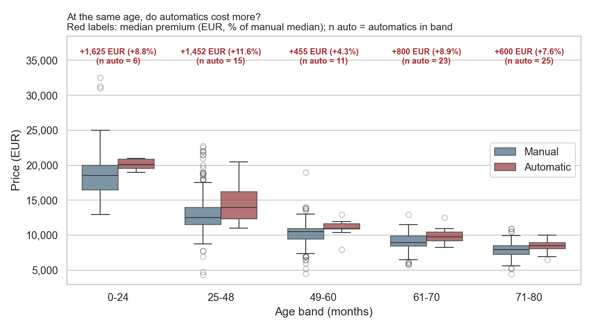
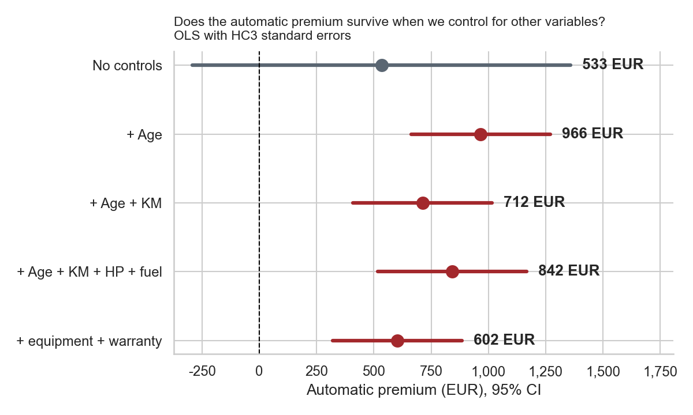

# Automatic gearbox: do you pay for it?
### Exploratory data analysis of 1,435 used Toyota Corollas


A private buyer wants to know whether a used Toyota Corolla with an automatic gearbox costs more than a manual one, and by how much. This project answers that with exploratory analysis of used-car listings from the Netherlands (2004), with a focus on data quality checks and on testing whether a third variable changes the picture.

## Key finding

In a raw comparison there is almost no price difference: the median price is **€9,900 for manuals and €9,950 for automatics**. But automatics in the sample are older (median age 65 vs 60 months), and age is the strongest driver of price (r = −0.88). When cars of the **same age** are compared, the automatic is more expensive in **every one of five age bands**, by €455 to €1,625, which is 4% to 12% of the price (about 8% in most bands). In euros the premium shrinks with age, but as a share of the price it stays roughly constant. After controlling for age, mileage, engine, fuel, equipment and warranty, an estimated premium of about **€600 to €970 (about 7% of the price)** remains.

| Comparison | Automatic premium |
|---|---|
| Raw, no controls | €533 (95% CI includes zero) |
| Same age band (median difference) | €455 to €1,625 (4% to 12%) in each band |
| Regression, controlling for age | €966 |
| + mileage, engine power, fuel, equipment, warranty | €602 (95% CI €321 to €884) |
| Log-price model | +7.1% (95% CI 4.6% to 9.7%) |





## What the analysis covers

1. **Research questions.** Four questions derived from the buyer's decision: description, relationship, prediction and causality. For each one, the variables in the file and what is missing.
2. **Data quality.** A documented issue log with location, extent and decision for each problem: an engine size of 16,000 cc fixed to 1,600, the CC column stored as text, a duplicated listing, hidden non-breaking spaces in model names, mileage of 1 km on 50 and 76 month old cars (disguised missing values), an implausible weight, constant and near-constant columns, an inconsistent gears column, univariate and bivariate outliers.
3. **Graphs.** Six graphs, each titled with the question it answers and followed by a one-sentence insight with a number. Graph 3 is the third-variable check (age).
4. **Robustness.** Bootstrap confidence intervals per age band, comparable engines only (petrol, 86 to 110 hp), excluding suspicious mileage, equipment compared within age bands, and OLS regressions with HC3 robust standard errors.
5. **Summary for the stakeholder.** What to tell the buyer, hypotheses for further work, and what this data cannot tell us.

## Limitations

The data contain asking prices, not transaction prices, and only 80 automatics (6 in the youngest age band). Seller type, accident history and number of previous owners are not recorded, so the premium is an estimate from observational data, not a causal effect. Most automatics are listed with 5 gears, which suggests many may be robotized manuals rather than classic automatics. The 107 hp engine exists only with an automatic, and there are no diesel automatics.

## Repository structure

```
toyota-corolla-eda/
├── toyota_eda.ipynb      # full analysis (runs top to bottom)
├── Toyota_Corolla_cars.xlsx        # original data, sheet "data"
├── requirements.txt
├── figures/                        # graphs saved by the notebook (g1 to g6)
├── images/cover.jpg                # cover illustration
└── docs/toyota_automatic_report.docx   # written report of the workflow (Hebrew)
```

## How to run

```bash
git clone https://github.com/NirAvrahamoff/toyota-corolla-eda.git
cd toyota-corolla-eda
pip install -r requirements.txt
jupyter lab toyota_eda.ipynb
```

Run all cells (Kernel, Restart Kernel and Run All Cells). The notebook reads `Toyota_Corolla_cars.xlsx` from the same folder and saves the graphs to `figures/`. Tested with Python 3.11.

## Data

The Toyota Corolla dataset (1,436 used cars offered for sale in the Netherlands in late summer 2004, 39 variables) comes from Shmueli, Bruce, Gedeck and Patel, *Data Mining for Business Analytics* (Wiley). It is included here for reproducibility of a course assignment.

## Notes

The notebook text is in Hebrew; code, graph titles and axis labels are in English. The cover image is an AI-generated illustration of the main finding.

---

## תקציר בעברית

הפרויקט הוא מטלת ביניים בקורס ניתוחי מידע בתובנות סטטיסטיות (אוניברסיטת אריאל). בעל העניין הוא קונה פרטי שרוצה לדעת אם משלמים יותר על קורולה משומשת עם תיבה אוטומטית. בהשוואה הגולמית אין כמעט הבדל במחיר, כי האוטומטיים מבוגרים יותר. באותו גיל האוטומט יקר יותר בכל קבוצות הגיל, בכ־8% מהמחיר ברוב הקבוצות, ואחרי בקרה על גיל, ק״מ, מנוע, דלק, ציוד ואחריות נשארת פרמיה מוערכת של כ־600 עד 970 €, כ־7% מהמחיר. זו הערכה מנתוני תצפית, לא הוכחה סיבתית.

מגישים: ניר אברהמוף, עינב ינון

**Authors:** Nir Avrahamoff and Einav Yinon, Industrial Engineering and Management, Ariel University
